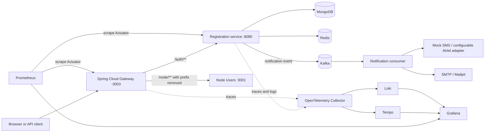
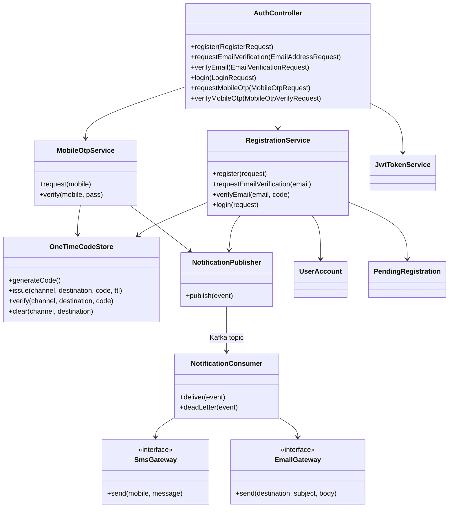
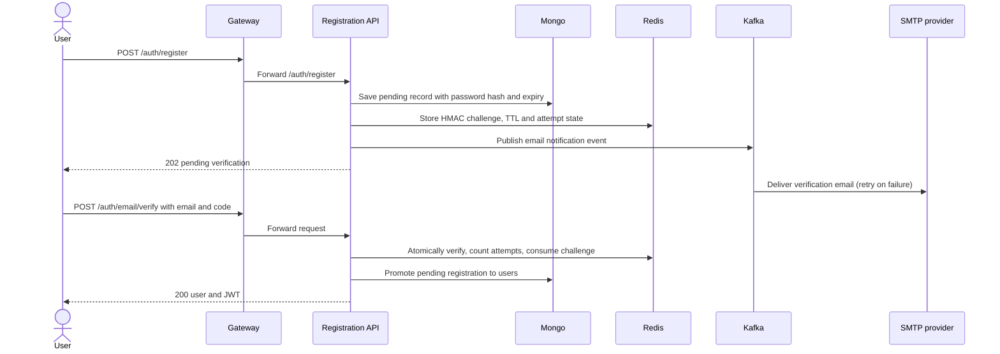
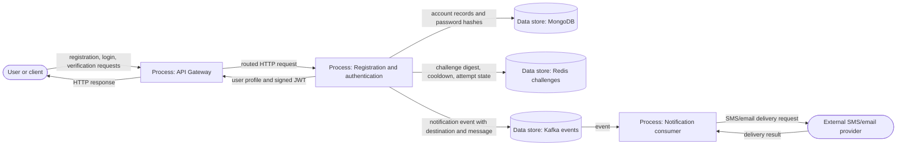

# Java Registration Microservice: SDLC and Architecture

## 1. Purpose and requirements

This service adds Java/Spring registration and sign-in flows alongside the existing Node.js user application.

### Functional requirements

| ID | Requirement | Implementation |
| --- | --- | --- |
| FR-01 | Register with email, name, and password | `POST /auth/register` creates a pending registration and queues a verification email. |
| FR-02 | Verify email before activating an account | `POST /auth/email/verify` consumes the single-use email challenge and creates an active user. |
| FR-03 | Sign in with an active email account | `POST /auth/login` checks the BCrypt password hash and returns a Node-compatible JWT. |
| FR-04 | Register/sign in with mobile OTP | `POST /auth/mobile/request-otp` and `POST /auth/mobile/verify-otp`. |
| FR-05 | Deliver verification messages asynchronously | Kafka notification events are consumed by email/SMS adapters, retried, then sent to a dead-letter topic. |
| FR-06 | Preserve interoperability with Node users | Verified accounts use the shared MongoDB `users` collection and compatible JWT claims/signing secret. |
| FR-07 | Support local development without paid providers | Local profile uses mock SMS code delivery and Mailpit SMTP. |
| FR-08 | Expose health, metrics, and telemetry | Spring Actuator probes and Prometheus metrics; OpenTelemetry traces/logs are exported to the existing Collector. |
| FR-09 | Route Java and Node APIs through one gateway | Gateway host port `3003` routes `/auth/**` to Java and `/node/**` to Node (removing `/node`). |

### Non-functional requirements and constraints

- Java 21, Spring Boot 3.4.4, Spring Cloud Gateway 2024.0.1.
- Challenges are single-use, expire, enforce resend cooldown and attempt limits, and are stored as keyed hashes in Redis.
- Credentials, passwords, codes, and message bodies must not be written to application logs.
- Local Compose is a development stack, not a highly available production design.
- The Airtel transport adapter is configurable, but its request mapping has **not** been validated against a live Airtel tenant contract. Obtain and validate tenant API, authentication, sender-ID, DLT, and payload requirements before production use.

## 2. High-level design (HLD)



### Component responsibilities

| Component | Responsibility | Local endpoint |
| --- | --- | --- |
| API Gateway | Host-facing route selection and Java/Node API aggregation | `http://localhost:3003` |
| Registration service | Validation, registration/login, JWT creation, and notification event production | Internal `registration-service:8080` |
| MongoDB | Shared active `users` collection; pending Java email registrations kept separately | Internal Compose service `mongo:27017` |
| Redis | OTP/email challenge state, HMAC digests, cooldowns, and incorrect-attempt counters | Internal `redis:6379` |
| Kafka | Durable asynchronous notification topic and retry/dead-letter flow | Internal `kafka:9092` |
| Notification consumer | Dispatches SMS and email events through provider interfaces | Runs in registration service |
| Mailpit | Local SMTP sink and browser mailbox for verification emails | `http://localhost:8025` |
| Prometheus | Scrapes gateway and service Actuator metrics | `http://localhost:9090` |
| Grafana | Dashboards over Prometheus, Tempo, and Loki | `http://localhost:3002` |

## 3. Low-level design (LLD)

### Authentication and registration APIs

All Java routes are exposed at the same path through the gateway.

| Method and path | Request fields | Success | Purpose |
| --- | --- | --- | --- |
| `POST /auth/register` | `name`, `email`, `password` | `202 Accepted` | Begin email registration and queue email challenge. |
| `POST /auth/email/request-verification` | `email` | `202 Accepted` | Re-queue verification for a pending account. |
| `POST /auth/email/verify` | `email`, `code` | `200 OK`, user and token | Verify and activate the pending email account. |
| `POST /auth/login` | `email`, `password` | `200 OK`, user and token | Authenticate an active email account. |
| `POST /auth/mobile/request-otp` | `mobile` in E.164 format | `200 OK` | Issue and queue a mobile OTP. |
| `POST /auth/mobile/verify-otp` | `mobile`, `pass` | `201 Created` for new account; `200 OK` for existing | Consume OTP and return user and token. |

Error responses use HTTP status codes to distinguish invalid input, rejected credentials/challenges, cooldown/attempt limits, and unavailable dependencies. Treat any OTP in a mock response as a development-only value.

Example email registration and verification:

```sh
curl -i http://localhost:3003/auth/register \
  -H 'Content-Type: application/json' \
  -d '{"name":"Example User","email":"person@example.test","password":"ReplaceWithARealPassword123"}'

# In local Compose, inspect the message at http://localhost:8025 and use its code:
curl -i http://localhost:3003/auth/email/verify \
  -H 'Content-Type: application/json' \
  -d '{"email":"person@example.test","code":"REPLACE_WITH_EMAIL_CODE"}'
```

Example mobile flow in the default local mock mode:

```sh
curl -i http://localhost:3003/auth/mobile/request-otp \
  -H 'Content-Type: application/json' \
  -d '{"mobile":"+15551234567"}'

curl -i http://localhost:3003/auth/mobile/verify-otp \
  -H 'Content-Type: application/json' \
  -d '{"mobile":"+15551234567","pass":"REPLACE_WITH_delivery.pass"}'
```

### Challenge lifecycle and limits

- Codes are six digits and generated using `SecureRandom`.
- The Redis key uses a keyed identifier of the destination; stored code values are HMAC digests, not plaintext.
- Mobile challenge TTL is five minutes; email challenge TTL is fifteen minutes.
- A 60-second cooldown prevents repeated challenge requests; at most five incorrect attempts are permitted.
- A Redis Lua script performs challenge comparison, attempt accounting, and successful consumption atomically.
- A replay, expired code, or wrong code is rejected. Redis unavailability produces a service-unavailable response.
- Only the `local` profile with `SMS_PROVIDER=mock` may expose a mock SMS code. Provider mode and profile validation must remain in force when changing local Compose defaults.

### Data model and ownership

| Mongo collection | Stored data | Lifecycle |
| --- | --- | --- |
| `users` | Active account fields: id, name, normalized email and/or mobile, BCrypt password hash where applicable, verification timestamps, created/updated timestamps | Shared with Node; unique indexes protect normalized email/mobile identity. |
| `java_registration_pending` | Pending email, name, BCrypt password hash, creation time, expiry | Promoted to `users` only after a valid email challenge; pending record expires. |

Redis challenge keys are namespaced by channel and keyed destination identifier. They contain the HMAC digest, TTL, attempt counter, and cooldown state. Kafka topic `registration.notifications` contains notification events with an event ID, channel, destination, optional subject, body, and creation timestamp. This event includes delivery information, so Kafka ACLs, encryption, retention, and broker access controls are mandatory in production.

### Class diagram



## 4. Data-flow and interaction diagrams

### Email registration



### Mobile OTP registration/sign-in

```mermaid
sequenceDiagram
    actor User
    participant Gateway
    participant API as Registration API
    participant Redis
    participant Kafka
    participant SMS as Mock or Airtel adapter
    participant Mongo

    User->>Gateway: POST /auth/mobile/request-otp
    Gateway->>API: Forward request
    API->>Redis: Create HMAC challenge and cooldown
    API->>Kafka: Publish SMS notification event
    API-->>User: Accepted; mock code only in local mock mode
    Kafka->>SMS: Send message
    User->>Gateway: POST /auth/mobile/verify-otp
    Gateway->>API: Forward request
    API->>Redis: Atomically check and consume code
    API->>Mongo: Find or create verified mobile account
    API-->>User: 201 created or 200 existing; user and JWT
```

### Data-flow diagram (DFD)



## 5. Security, privacy, and failure handling

- Passwords use BCrypt; plaintext passwords and verification codes are not stored in MongoDB or Redis.
- JWTs are signed with the same `JWT_SECRET` as Node to preserve account interoperability. Protect and rotate the secret as a coordinated cross-service operation.
- HMAC challenge keys require a separate high-entropy `OTP_HMAC_SECRET`; the example fallback to JWT secret is for compatibility and should be replaced in deployment.
- The API does not log codes, credentials, full destinations, or notification bodies. Avoid adding such fields to structured logs or metrics labels.
- Keep Redis and Kafka internal; provision authenticated/encrypted brokers, ACLs, TLS, network policy, and least-privilege service identities before production.
- Gateway rate limiting, bot protection, HTTPS termination, CSRF/session considerations, secret management, Mongo backup/restore, and multi-instance failover are deployment responsibilities not supplied by this local Compose stack.
- Kafka consumer delivery is at-least-once in practice; provider adapters and operational procedures must account for potential duplicates. Failed events are retried four total attempts with exponential backoff and routed to a `.dlt` topic.
- Airtel mode must fail startup when required provider settings are missing. Confirm the provider's idempotency and error-response behavior with the tenant.
- Health endpoints are operational checks, not authorization. Restrict Actuator and Prometheus endpoints to trusted networks in production.

## 6. Deployment, configuration, and operations

### Local ports

| Host port | Service |
| --- | --- |
| `3001` | Existing Node application |
| `3003` | Java API Gateway |
| `3002` | Grafana (loopback only) |
| `9090` | Prometheus (loopback only) |
| `8025` | Mailpit UI (loopback only) |

Redis, Kafka, the Java API, and telemetry backends are internal to the Compose network. Gateway routes are `/auth/**` for Java and `/node/**` for Node (with the `/node` prefix removed). Direct Java service access is not published to the host.

### Key environment configuration

Copy `.env.example` to `.env`, use unique local secrets, and never commit `.env`.

| Variable | Purpose |
| --- | --- |
| `JWT_SECRET` | Shared HS256 signing secret for Node/Java login compatibility. |
| `OTP_HMAC_SECRET` | Key used to digest verification codes and destination identifiers. |
| `OTP_EXPOSE_CODE` | Local mock-only code disclosure; must be false outside development. |
| `SPRING_PROFILES_ACTIVE` | Defaults to `local`; mock code exposure depends on the local profile. |
| `SMS_PROVIDER` | `mock` for development or `airtel` after tenant configuration/validation. |
| `AIRTEL_SMS_API_URL`, `AIRTEL_SMS_AUTH_*`, `AIRTEL_SMS_CUSTOMER_ID`, `AIRTEL_SMS_SENDER_ID`, `AIRTEL_SMS_TEMPLATE_ID` | Tenant-specific SMS endpoint, credentials, and required template parameters. |
| `SMTP_*`, `EMAIL_FROM` | SMTP delivery settings; local Compose defaults to Mailpit. |
| `REGISTRATION_PUBLIC_BASE_URL` | Public URL inserted into verification links; defaults to gateway `http://localhost:3003`. |

Build and start:

```sh
docker compose up -d --build registration-service api-gateway
docker compose ps
curl -fsS http://localhost:3003/actuator/health
```

The gateway health URL checks the gateway itself. Useful direct container checks for the internal registration service and gateway:

```sh
docker compose exec registration-service curl -fsS http://127.0.0.1:8080/actuator/health
docker compose exec api-gateway curl -fsS http://127.0.0.1:8081/actuator/health
```

Check Prometheus targets at <http://localhost:9090/targets>. Expected jobs include `registration-service` and `registration-api-gateway`; both should be `UP`. Open Grafana's **Java Registration Overview** dashboard. Search Loki for `registration-service` logs and Tempo for recent service traces. Confirm trace IDs in logs to verify correlation.

## 7. Verification and release gates

The multi-stage Java Docker build runs Maven tests for the selected module. The root Jenkins pipeline runs Compose/Node validation, builds the Node and Java images, and performs an isolated end-to-end smoke test including Java-to-Node token interoperability and Prometheus targets. Its disposable environment is defined in `ci/compose.env` and `ci/docker-compose.ci.yml`; it uses separate ports, project-scoped volumes, and removes only those volumes after the run. Before a release:

1. Run `docker compose config --quiet`.
2. Build both Java modules so the Maven test suite runs.
3. Check Compose health for Java, gateway, Redis, Kafka, and Mailpit.
4. Verify Prometheus targets and Grafana provisioning.
5. Exercise email registration, Mailpit delivery, email verification, and login.
6. Exercise mobile OTP request/verify, invalid or replayed code, cooldown, and attempt exhaustion with the mock provider.
7. Verify verified Java-created accounts can authenticate through the Node app using the shared JWT secret and `users` collection.
8. Confirm no secrets, OTP values, full destinations, or message bodies appear in logs.
9. Test Airtel only with an authorized tenant and its documented contract; a mock HTTP test only validates the configurable adapter's current mapping, not live Airtel compatibility.
10. Review `git status`; do not commit `.env`, runtime secrets, or generated test accounts.

## 8. CI/CD and host deployment

Jenkins CI is defined by the root `Jenkinsfile`. A configured Pipeline-from-SCM or Multibranch Pipeline job runs the checked-in pipeline on an agent with Node.js, Docker Engine/Compose, and access to a Docker daemon. The optional deployment stage uses Ansible only when explicitly selected on `main`; the agent needs Ansible and the stage installs the pinned `ansible.posix` collection.

The Ansible playbook targets a pre-provisioned host and uses rsync to transfer the checked-out application source. It excludes environment files and build/dependency directories, validates the host's `.env`, runs Compose build/up, and checks application/gateway readiness. It preserves Docker volumes. The target host, `.env`, SSH key, and firewall are managed by the operator. Terraform is intentionally not included: no cloud provider, account, network design, or budget was selected, and the existing Compose deployment does not require cloud provisioning.

```mermaid
flowchart LR
    SCM[Source repository]
    Jenkins[Jenkins pipeline]
    Validate[Compose and Node validation]
    Build[Docker image build and Java tests]
    CI[Isolated Compose test stack]
    Smoke[OTP, JWT, routes, metrics smoke checks]
    Approval[Manual DEPLOY opt-in on main]
    Ansible[Ansible over verified SSH]
    Host[Existing Docker host]

    SCM --> Jenkins --> Validate --> Build --> CI --> Smoke
    Smoke -->|pass| Approval -->|enabled| Ansible --> Host
```



The pipeline intentionally does not publish images: no trusted registry or registry credentials were selected. The Ansible release path transfers source and rebuilds on the target host; use an approved image registry and immutable tags if artifact promotion is required.

## 9. Known limitations and follow-up

- Airtel request fields/authentication are tenant-configurable assumptions, not a certified Airtel integration.
- Kafka/Redis local topology is single-node and does not model production availability, replication, security, or retention policy.
- Local mock OTP disclosure and Mailpit are for development only.
- Shared Node/Java identity storage means schema/index/secret changes must be coordinated.
- Add provider contract tests, rate limiting, production secrets management, automated security testing, and deployment-specific SLOs before production launch.
- CI validates and builds locally but does not publish to a registry. Select an approved registry and configure its credentials outside source control before adding immutable-image promotion.
- The Ansible deployment host must already have Docker Engine/Compose, rsync, SSH access, and a protected `.env`; provisioning and firewall management are outside the playbook's scope.
